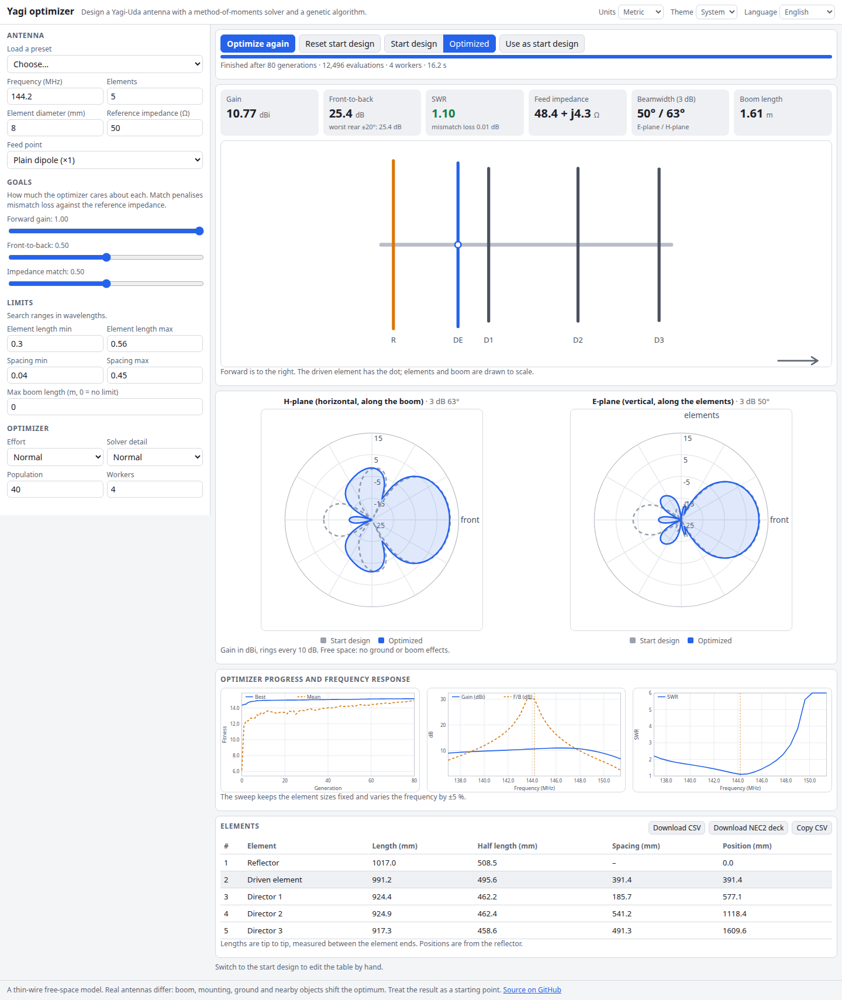

# Yagi Optimizer

Design a Yagi-Uda antenna in the browser. A method-of-moments thin-wire solver computes gain, front-to-back ratio, feed impedance and SWR, and a genetic algorithm running in Web Workers searches element lengths and spacings for the goals you weight. The best design updates live, with radiation patterns, a frequency sweep and an exportable element table.

**Try it: [hermes98761234.github.io/yagi-optimizer](https://hermes98761234.github.io/yagi-optimizer/)**

[](https://github.com/hermes98761234/yagi-optimizer/actions/workflows/deploy.yml)



## Features

- **Method-of-moments solver in TypeScript.** Parallel thin wires, mixed-potential (Pocklington-type) integral equation, piecewise-linear current basis, Galerkin testing, delta-gap feed.
- **Genetic algorithm in Web Workers.** One island per worker with migration of the best design, tournament selection, BLX crossover, elitism and a final compass-search polish.
- **Goals you control:** forward gain, front-to-back (worst direction within 20 degrees of the back) and match (mismatch loss against a reference impedance, with a plain or folded dipole feed). Limits on element length, spacing and maximum boom length.
- **Live best design:** metrics, to-scale boom drawing, E-plane and H-plane polar patterns compared with the start design, convergence chart, and a frequency sweep of gain, F/B and SWR (±5 %).
- **Editable start design** and presets for 2 m, 70 cm, 10 m, 6 m, 20 m, 137 MHz and 2.4 GHz.
- **Element table export:** CSV, copy to clipboard and a NEC2 card deck.
- English and Ukrainian, light/dark/system theme, metric or imperial units. Settings are stored in the browser; nothing leaves it.

## How it works

Each element is a straight wire parallel to z, centred on the boom (x axis). The solver fills the impedance matrix `Z = jkη ∫∫ (f_m f_n − f_m' f_n'/k²) G dz dz'` with the thin-wire reduced kernel, using Gauss-Legendre quadrature and analytic extraction of the 1/R singularity for near segment pairs. Every wire is centred and fed at its middle, so the current is even and only half of each wire is solved. The far field follows from the nodal currents in closed form; gain is referred to the input power.

Tests check the solver against textbook values: half-wave dipole impedance region and directivity (2.15 dBi), power conservation (radiated power equals input power), cosine current distribution, E-plane beamwidth, reciprocity and the mutual impedance of side-by-side dipoles, full-wave dipole gain, and the behaviour of classic 3-, 5- and 8-element Yagis.

## Limitations

- Free space, lossless round wires. No boom, ground, supports or element-to-boom correction; mount effects shift the optimum.
- The folded-dipole option only multiplies the feed impedance by 4.
- Triangle basis functions instead of Hallén/pulse or piecewise-sinusoidal bases. Impedance converges slowly with segmentation; the search uses 8-16 segments per element and the display 24.
- Gain-heavy optima can be narrowband; check the frequency sweep.

## Quick start

You need [Node.js](https://nodejs.org/) 22.

```bash
git clone https://github.com/hermes98761234/yagi-optimizer.git
cd yagi-optimizer
npm install
npm run dev       # http://localhost:5173
npm test          # solver, optimizer, export and i18n tests
npm run build     # static site in dist/
```

## License

MIT
